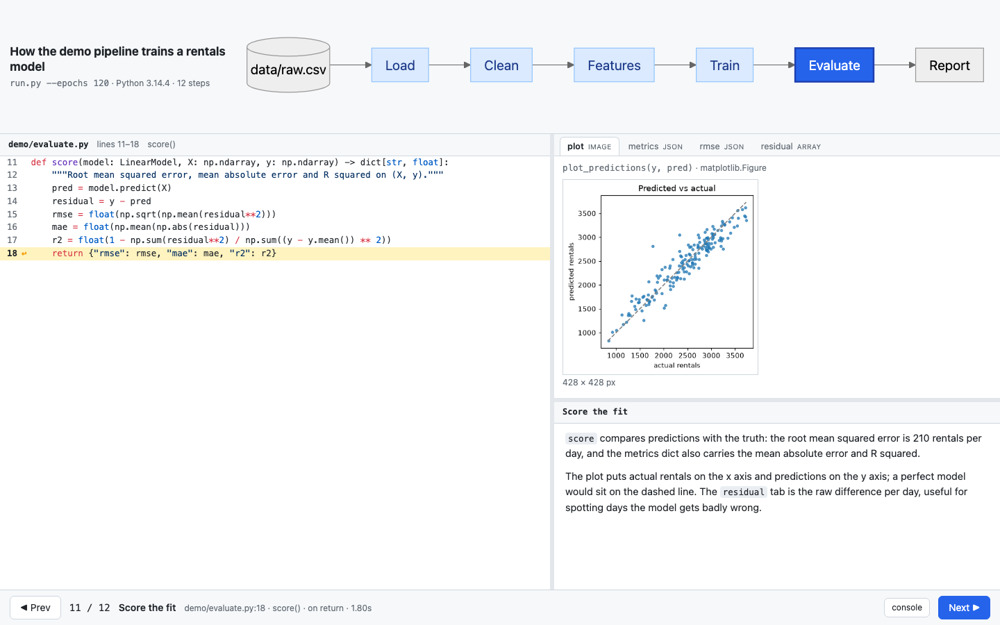
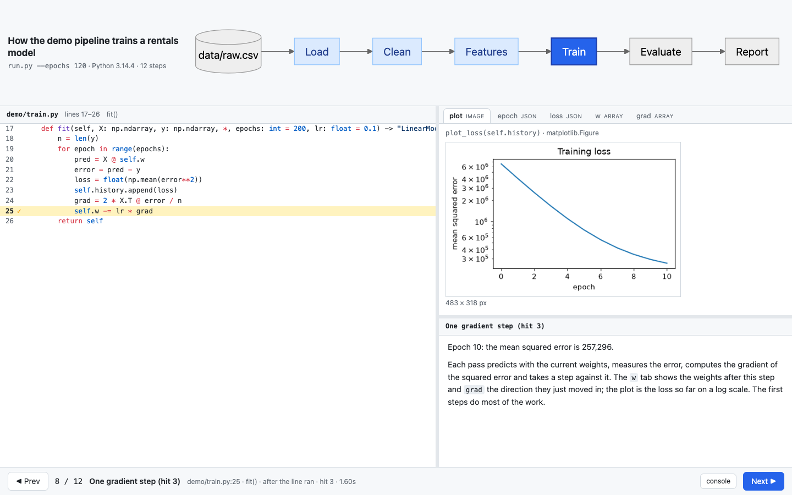

# codewalk

Agent-authored, debugger-style visual walkthroughs of Python codebases.

An agent (or a person) writes a small `walkthrough.py`: where to pause, what to show,
what to say. `codewalk record` runs the program once under a debugger, captures every
step, and writes a self-contained `index.html`. The reader presses **Next** through the
run: the project schema on top with the current stage highlighted, the paused code on
the left, the captured objects on the right, the explanation underneath.



The codebase being explained is never modified, and the viewer is prebuilt and shipped
inside the package, so users and agents only need Python.

## Try the demo

```bash
uv sync                                                      # or: pip install -e '.[screenshot]'
uv run codewalk check  examples/demo_pipeline/walkthroughs/train.py
uv run codewalk record examples/demo_pipeline/walkthroughs/train.py -o out/demo
uv run codewalk serve out/demo --open                        # or open out/demo/index.html directly
```

`examples/demo_pipeline` is a five-stage pipeline (load, clean, features, train by
gradient descent, evaluate) and `walkthroughs/train.py` is the reference walkthrough:
nine steps, one of them inside the training loop with four captured iterations.

To look at every page without a browser session (the way an agent reviews its work):

```bash
uv run playwright install chromium                           # once
uv run codewalk screenshot out/demo --all                    # out/demo/screenshots/NN-<step>.png
```



## Writing a walkthrough

`codewalk init` writes a commented `walkthrough.py` that already passes `codewalk check`.
The whole DSL:

```python
from codewalk import Walkthrough

walkthrough = Walkthrough(
    title="How the demo pipeline trains a rentals model",
    entry="run.py --epochs 120",          # script + args (run as __main__), or "pkg.module:function"
    root="..",                            # relative to this file; default: this file's directory
    schema="""
    flowchart LR
      load[Load] --> clean[Clean] --> feats[Features] --> train[Train] --> eval[Evaluate]
    """,                                  # or a list: ["Load", "Clean", "Features", "Train", "Evaluate"]
    description="Markdown shown before the first step.",
)

walkthrough.step(
    id="outliers",
    title="Remove counter glitches",
    at="demo/clean.py:23",                # pause before line 23; after="..." pauses once it has run
    highlight="clean",                    # schema node to mark as current
    focus="demo/clean.py:21-23",          # lines to emphasise (code= picks the window; default: the function)
    show={"outliers": "df[outliers]", "threshold": "MAX_RENTALS"},   # name -> expression in the paused frame
    text="Two days report over {{threshold}} rentals ...",          # Markdown; {{name}} inserts a show value
)

walkthrough.step(
    id="epoch",
    after="demo/train.py:25",
    highlight="train",
    hit="all", condition="epoch in (0, 1, 10, 119)",   # loops: hit=N, hit="all" (max_hits=10), condition=
    show={"epoch": "epoch", "loss": "round(loss)"},
    plot="plot_loss(self.history)",       # a matplotlib Figure, PIL image or image array, opened first
    text="Epoch {{epoch}}: the loss is {{loss}}.",
)

walkthrough.step(
    at="demo/evaluate.py::score", when="return",   # function entry, or its return with __return__
    highlight="eval",
    show={"metrics": "__return__"},
    text="...",
)
```

What the objects pane can show: pandas DataFrames and Series, numpy arrays and torch
tensors, matplotlib figures, PIL images and image arrays (`cw.image(arr)`), objects with
`_repr_html_`, JSON-like values, and `repr` for everything else. Each display is capped in
size, so a 10 GB frame costs a 20-row table.

Semantics worth knowing: a breakpoint on a line pauses **before** it runs (use `after=`
to see what it assigned); expressions run in the real frame and must not mutate state;
a failing expression becomes an error card plus a warning, never an aborted run; if the
program crashes, the traceback is recorded as the last step.

## Commands

| Command | What it does |
|---|---|
| `codewalk init [DIR] [--entry ...]` | Scaffold `walkthrough.py` with the detected entry script |
| `codewalk check walkthrough.py` | Validate paths, lines, expressions and schema ids without running |
| `codewalk record walkthrough.py -o out` | Run once; write `out/steps.json` and `out/index.html` (`--strict`, `--timeout`, `--backend`, `--json-only`) |
| `codewalk screenshot out --all` | Render every step to PNG with Playwright (`--step ID`, `--dark`, `--width/--height`) |
| `codewalk serve out [--open]` | Serve the folder locally |
| `codewalk build out/steps.json` | Rebuild `index.html` from a recording, e.g. after a viewer upgrade |

Exit codes: 1 for spec errors, 2 for warnings or a crash under `--strict`, 3 for a timeout.

## For agents

`skills/codewalk/SKILL.md` is the agent-facing manual: the workflow (read, draw the
schema, choose 6 to 15 breakpoints, write, check, record, screenshot, fix), the DSL,
guidelines for choosing breakpoints and writing text, and what every warning means.
Copy or link the folder into `.claude/skills/` (this repository links it) or into
`~/.claude/skills/` so that Claude Code picks it up; the file is plain Markdown and
works for any agent.

## How it works

- `codewalk.spec` is the DSL and its validation (pydantic). `codewalk.check` resolves
  every path and line against the source and reports errors in one line each.
- `codewalk.recorder` subclasses `bdb.Bdb`: one breakpoint per step, hit counting,
  conditions, `after=` through `set_next`, returns through `user_return`. On Python 3.14
  it uses the `sys.monitoring` backend, on older versions `sys.settrace`. The run happens
  in a child process with a timeout.
- `codewalk.serialize` turns values into one of seven display kinds (`table`, `array`,
  `image`, `html`, `json`, `text`, `error`) without importing any optional library.
- `codewalk.build` embeds the recording into the viewer template; `codewalk.screenshot`
  drives the page with Playwright and waits for the panes to settle.
- The viewer (`viewer/`, Vite + React + TypeScript) renders the schema with Mermaid and
  the code with Shiki, follows the system colour scheme, supports keyboard navigation
  and `?step=<id>` deep links, and jumps to a step when a schema node is clicked.

## Development

```bash
uv sync && uv run playwright install chromium   # dev group includes playwright
uv run pytest                                  # Python tests (screenshot tests skip without Chromium)
cd viewer && npm install && npm run build      # rebuilds src/codewalk/viewer/index.html (committed)
cd viewer && npm run dev                       # viewer with fixtures/steps.json, the demo recording
```

Layout: `src/codewalk/` (package), `viewer/` (viewer source), `examples/demo_pipeline/`
(demo project and reference walkthrough), `skills/codewalk/` (agent skill),
`tests/` (pytest, with two fixture projects), `docs/` (spec and research notes).

Status: milestones 1 to 4 of `docs/spec.md` are done. Not yet: live mode, plotly
displays, nested schemas, a VS Code wrapper.
